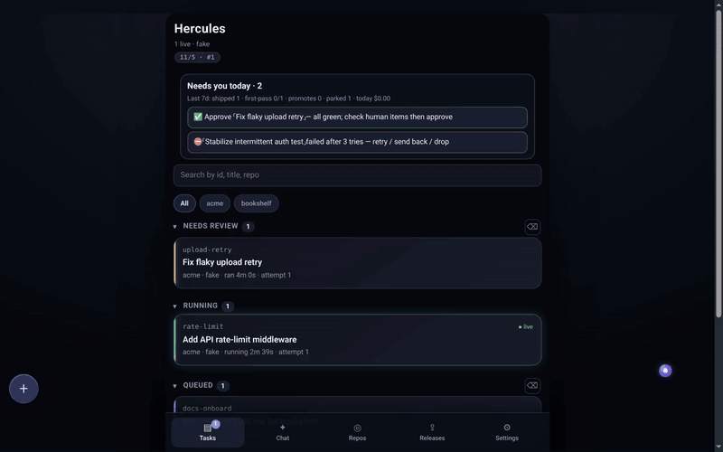
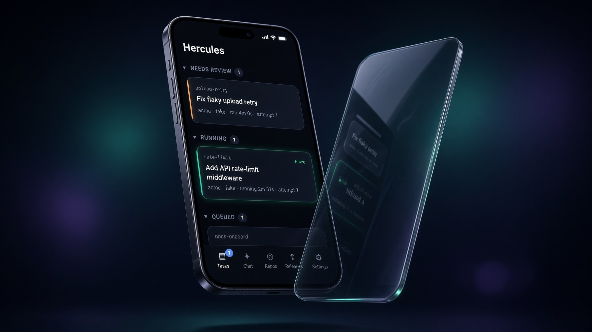
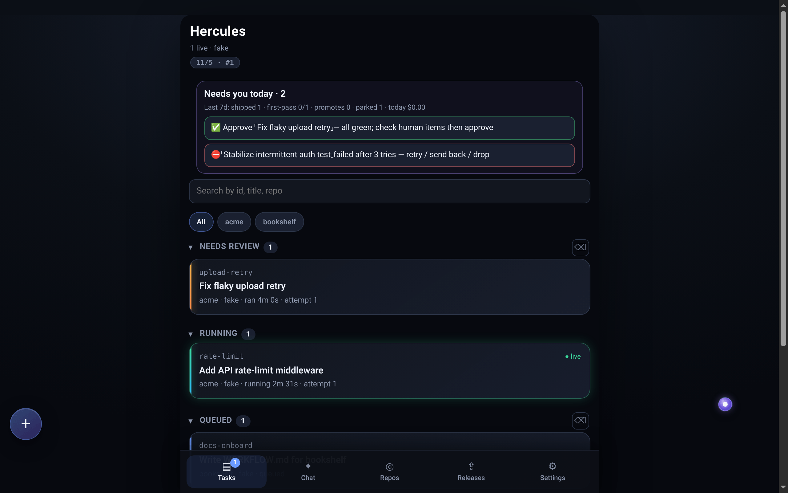
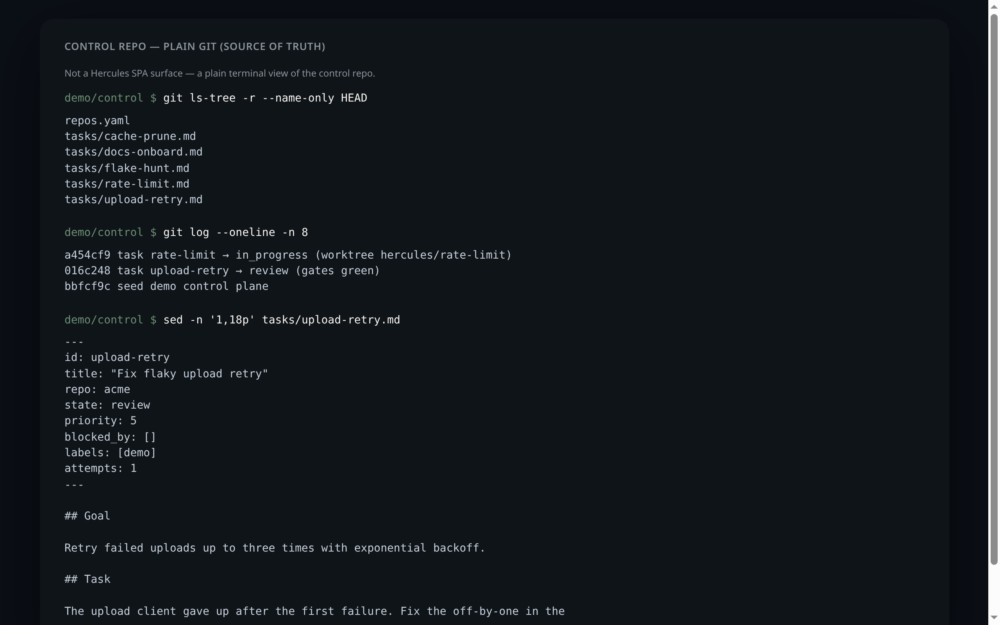
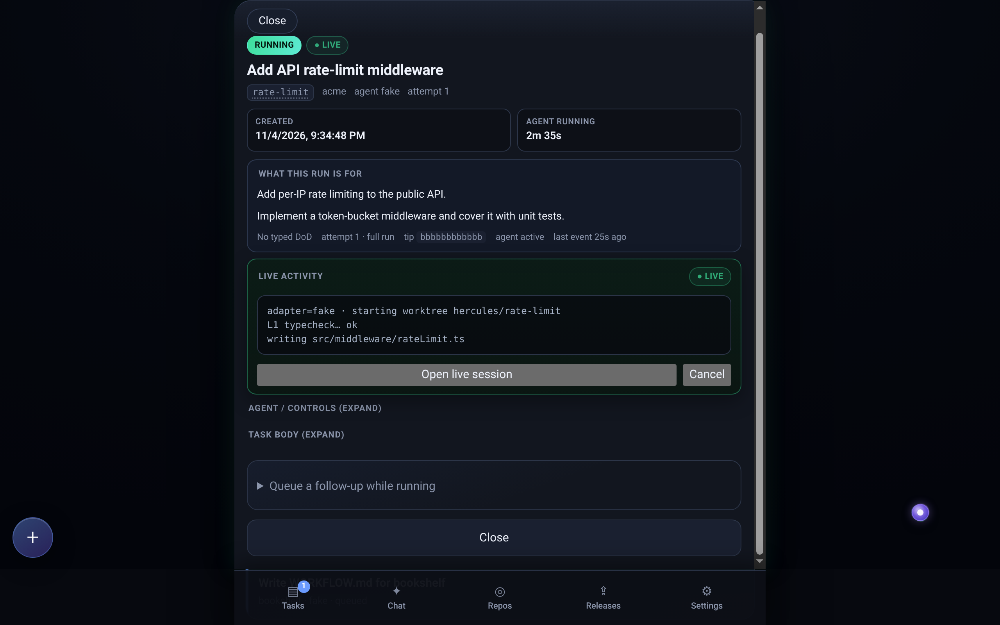
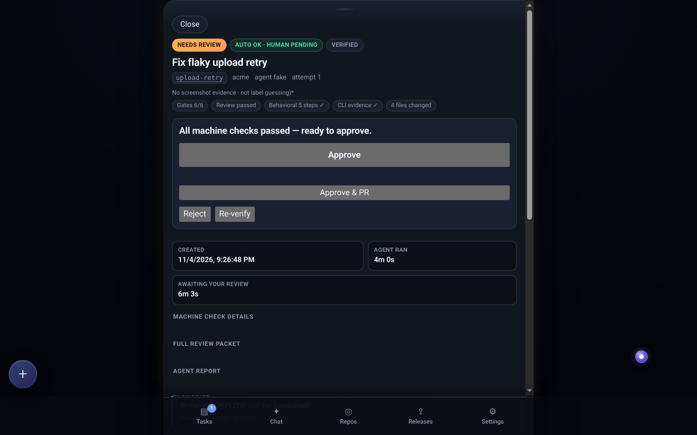
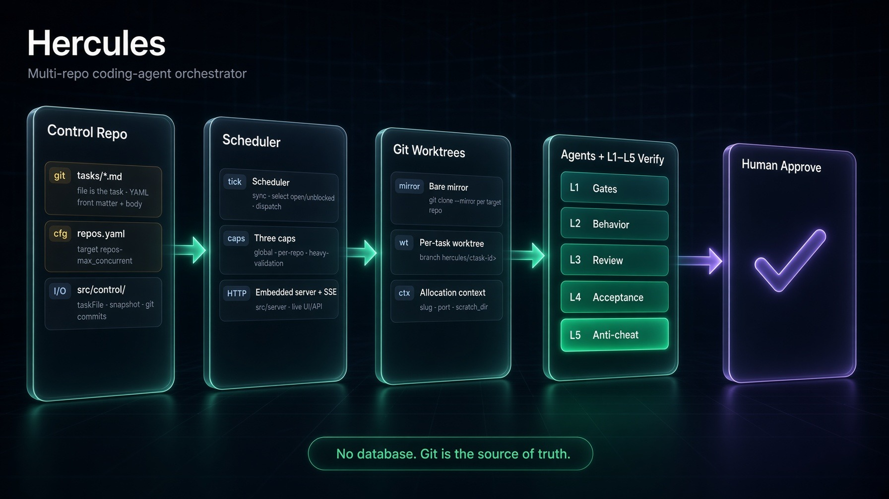

# Hercules


*Concept art generated with Grok Imagine; see screenshots below for the real UI.*

> **Status: experimental reference code.** Hercules is a personal research
> project, published as-is for study and reuse. Issues and pull requests are
> welcome; responses are best-effort.

Hercules is a single-box, multi-repo **coding-agent orchestrator** written in
TypeScript. It turns a git "control repo" of markdown task files into a control
plane. Every open, unblocked task gets exactly one coding agent, running in its
own git worktree. The agent must verify its own work before a human sees it.
The human then reviews a compact "review packet" (from a phone, if desired)
instead of supervising the agent.

The one-sentence invariant (from [`SPEC.md`](./SPEC.md) §0):

> For every open, unblocked task, guarantee that exactly one coding agent is
> running in its own isolated workspace — and that the agent can verify its own
> work before a human ever looks at it.




Static stills below. Motion: desk overview → open a green review packet → Approve → cut to the control repo in plain git.



*Concept art generated with Grok Imagine; the real desk UI is in the screenshots that follow.*



## Key design ideas

### 1. Git is the source of truth — no database in the core

- A task is a markdown file: `tasks/<id>.md` in the control repo
  (SPEC §3.1–3.2). The file *is* the task.
- Every state change is: validate the state machine → write the file →
  `git commit`. The control repo's git history is the audit log.
- The runtime snapshot is **derived** from disk + git on every tick and is never
  persisted. A crashed daemon loses nothing; it rebuilds state on restart
  (SPEC §1, §17: "No external database (git is the store)").

Note: a later, experimental "Hercules 2" track added an optional SQLite
*shadow* state store (`src/control/state/sqliteStateStore.ts`). It is **off by
default** and only starts when both `HERCULES_V2_SHADOW_ROOT` and
`HERCULES_V2_SHADOW_DATABASE` are set (`src/main.ts`,
`createM4ShadowStoreFromEnv`). The task files in git remain the authority for
the core flow.



### 2. Physical isolation with git worktrees

- Each target repo gets one local **bare mirror** (`git clone --mirror`).
- Each task gets its **own worktree on its own branch** (`hercules/<task-id>`),
  cut from that mirror (SPEC §8.1–8.2, `src/isolation/worktree.ts`).
- Tasks in different repos cannot touch each other. Two tasks in the same repo
  share an object store but have independent working trees and branches.
- The worktree path must resolve inside the isolation root before any agent
  runs. Task ids and repo keys must match `[A-Za-z0-9._-]` (SPEC §10).
- Each worktree gets an allocation context — `{slug}`, `{port}`,
  `{scratch_dir}` — so a repo's boot hook can start an isolated app instance
  without port or data collisions (SPEC §8.3).



### 3. Self-verification: the five-layer closed loop

The agent closes its own loop: produce work, check it against machine-readable
signals, fix, repeat. A run reaches `review` only when its own verification is
green (SPEC §9). Layers, cheapest first:

| Layer | Name (SPEC §9) | What it does | Code |
|---|---|---|---|
| **L1** | Mechanical gates | Typecheck, lint (including architectural lints), build, and the test suite. Lint/error messages should embed the fix ("to fix this, do X"). | `src/verification/gates.ts` |
| **L2** | Behavioral verification | The agent boots the app inside its worktree and drives it. Bugs: reproduce, fix, prove the repro no longer triggers. UI: drive via the Chrome DevTools Protocol (navigate, DOM snapshot, screenshot). Holds a single heavy-validation permit. | `src/verification/behavioral.ts`, `browser.ts`, `cdp.ts` |
| **L3** | Agent-as-reviewer | A **separate reviewer agent with a fresh context** critiques the diff against the acceptance criteria and repo principles: missed intent, over-engineering, scope creep, security smells. On by default; `HERCULES_REVIEWER=0` disables it. | `src/verification/reviewer.ts` |
| **L4** | Acceptance contract | "Done" must be defined. Tasks carry checkable acceptance criteria, encoded as tests where possible. A vague task first produces a plan + criteria for human sign-off. | `src/domain/acceptance.ts` |
| **L5** | Anti-cheating guardrails | Flags edits to the tests a change must satisfy, protected-path edits, removed test cases, and silencing tricks (`eslint-disable`, `@ts-ignore`, `.skip`/`.only`, blanket `as any`, empty `catch`). The reviewer is asked: "did it satisfy the spirit, or game the metric?" | `src/verification/antiCheat.ts`, `testIntegrity.ts` |

The output of verification **is** the review packet (SPEC §9.6): diff summary,
gate results, L2 screenshots or recordings, the reviewer verdict, and the
agent's self-assessment.



### 4. Policy lives in repos; coordination lives in the daemon

Each target repo carries a `WORKFLOW.md` (template:
[`WORKFLOW.template.md`](./WORKFLOW.template.md)). Its YAML front matter holds
the gate and boot commands the daemon executes. Its body is prepended to every
agent prompt. The daemon reads `WORKFLOW.md` from the repo's **trusted default
branch**, never from the agent's worktree, so a task cannot rewrite its own
gates.

### 5. Humans keep the irreversible actions

Agents work only on `hercules/<task-id>` branches. Merge to `main` requires a
human **Merge**; production deploy requires a human **Promote** (SPEC §10).
Content in task files, repo files, tool output, and agent output is treated as
data, never as commands.

## Architecture



*Concept art generated with Grok Imagine; the ASCII diagram below is the exact layout.*

One Node.js process with three logical layers (SPEC §2):

```
 phone / browser ──► HTTP API + SSE + mobile web UI     (presentation)
                     Orchestrator: tick loop, caps,      (coordination)
                     reconciliation, retry, verifier
                     Agent adapters: grok | codex |      (execution)
                     claude (opt-in) | cursor | fake
        reads/writes │
   control repo (git): tasks/*.md, repos.yaml     target repos: WORKFLOW.md + code
```

Concurrency uses three caps: global, per-repo, and a heavy-validation
semaphore for L2 (SPEC §6).

Source layout:

```
src/domain/         pure types + logic (no I/O; enforced by ESLint)
src/control/        control-repo I/O (tasks/*.md, repos.yaml, snapshot, git)
src/orchestrator/   tick loop, caps, actions, adapter contract, verifier wiring
src/isolation/      bare mirrors, per-task worktrees, ports
src/adapters/       agent CLIs: grok (default), codex, claude (opt-in), cursor
src/verification/   L1 gates, L2 behavioral/browser, L3 reviewer, L5 anti-cheat, packet
src/server/, web/   Hono API + SSE + mobile SPA
test/               mirrors src/; test/invariants/ holds structural gates
examples/           a tiny sample control repo and a readiness-pipeline example
```

Read [`SPEC.md`](./SPEC.md) for the full design and
[`AGENTS.md`](./AGENTS.md) for the short agent-facing map.

## Quick start

Requirements:

- Node.js ≥ 20.10 and pnpm 9 (via corepack).
- Linux. The CLI-evidence sandbox uses `bubblewrap` (`/usr/bin/bwrap`).
- For real runs: an agent CLI on `PATH` and logged in — Grok Build (`grok`,
  default) or Codex (`codex`). The `fake` adapter needs nothing.

```bash
corepack enable
pnpm install
pnpm build

# Make a control repo from the example (it must be its own git repo):
cp -r examples/control-repo /tmp/hercules-control
git -C /tmp/hercules-control init -q && git -C /tmp/hercules-control add -A \
  && git -C /tmp/hercules-control commit -qm "init control repo"

# Dry run — no agent cost, no workspaces:
HERCULES_ADAPTER=fake pnpm start /tmp/hercules-control

# Real run (default adapter: grok):
HERCULES_TOKEN=$(openssl rand -hex 16) pnpm start /tmp/hercules-control
```

Open `http://<host>:8787/` and paste the token. Hercules prints the token to
stderr, never in the URL.

**Security:** the UI can launch agents with broad permissions. Always require
the token, and never expose the port to the open internet. Put it behind a
private network or an authenticated tunnel (SPEC §10).

Useful environment variables:

| Variable | Meaning |
|---|---|
| `HERCULES_ADAPTER` | `grok` (default), `codex`, `claude` (needs `HERCULES_CLAUDE_ENABLED=1`), `cursor`, `fake` |
| `HERCULES_TOKEN` | API/UI bearer token |
| `HERCULES_PORT` | HTTP port (default `8787`) |
| `HERCULES_WORK_DIR` | Root for mirrors and worktrees |
| `HERCULES_PUSH=1` | Push task branches to the remote |
| `HERCULES_REVIEWER=0` | Disable the L3 reviewer |

## Development

```bash
pnpm check        # fast gate: typecheck + lint + unit tests
pnpm check:full   # full gate: + all tests + build + SPA smoke
pnpm test:watch   # watch mode
```

House rules (see [`AGENTS.md`](./AGENTS.md)): TypeScript strict mode, no
`any`, no empty `catch`, no `eslint-disable`, no `.skip`, no `@ts-ignore`.
A bug fix needs a test that would have failed before the fix.

See [`CONTRIBUTING.md`](./CONTRIBUTING.md). To report a security issue, see
[`SECURITY.md`](./SECURITY.md).

## Background

The design draws on two public ideas from OpenAI's writing: *harness
engineering* (agent-legible, mechanically enforced environments) and the
*Symphony* orchestration pattern (the task tracker as control plane). Hercules
is an independent, tracker-agnostic and agent-agnostic reimplementation
(SPEC §1, §19).

## License

Released under the MIT License. See [`LICENSE`](./LICENSE).
